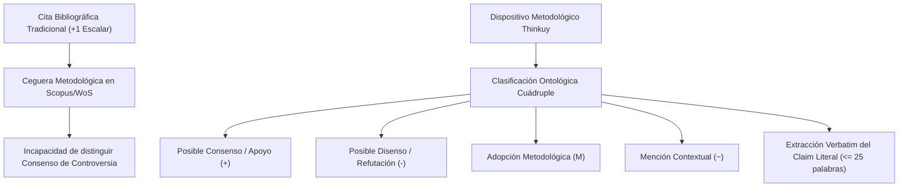

# Artefacto Metodológico de Tesis: Auditoría Epistémica Automatizada y Análisis Retórico de Citas en Revisiones Sistemáticas

> **Tipo de Documento**: Propuesta y Fundamentación Metodológica para Tesis Doctoral / Maestría  
> **Proyecto / Dispositivo**: Thinkuy — Radar de Comunicación Científica (Tinkuy Lab)  
> **Fecha de formulación**: Septiembre 2026  
> **Estado de desarrollo**: Validado empíricamente (60/60 tests unitarios, réplica bibliométrica de Duque 2019 y cacería de controversias en 83 PDFs de la RPP).

---

## 1. El Problema Epistemológico de Fondo: La Ceguera Métrica de la Citación Escalar

En la cienciometría contemporánea y en las bases de datos bibliográficas hegemónicas (**Scopus, Web of Science, Google Scholar**), la citación académica se reduce a una **métrica escalar acumulativa y plana ($+1$)**:

* Una cita que **refuta, invalida o expone un error metodológico** en una investigación previa suma $+1$.
* Una cita que **adopta o replica fielmente el protocolo experimental** suma $+1$.
* Una cita meramente **decorativa o de contextualización superficial** suma $+1$.
* Una cita de **consenso y confirmación de hallazgos** suma $+1$.

### La "Falacia de la Citación Normativa"
Esta indiferenciación introduce una distorsión epistémica severa en las revisiones sistemáticas de literatura (**PRISMA-ScR / JBI PCC**): una obra altamente citada puede ser considerada equivocadamente como "sólida y consensuada", cuando en realidad su alto impacto bibliométrico podría deberse a una ola de refutaciones o críticas metodológicas.



---

## 2. Los Cuatro Pilares del Dispositivo Metodológico

```
┌─────────────────────────────────────────────────────────────────────────────┐
│ 1. MARCO TEÓRICO RETÓRICO (Toulmin & Moravcsik)                             │
│    • 4 posturas ontológicas: Consenso, Disenso, Metodología, Mención.      │
│    • Regla de oro: Extracción de 'Claim' verbatim (cero alucinaciones).     │
├─────────────────────────────────────────────────────────────────────────────┤
│ 2. CURADURÍA Y BALANCEO DE DATOS (Dataset Maestro Bilingüe)                 │
│    • Ingesta de SciCite + Enriquecimiento Nativo Iberoamericano (Dialnet).  │
│    • Superación de la asimetría del disenso mediante oversampling x3.       │
├─────────────────────────────────────────────────────────────────────────────┤
│ 3. INGENIERÍA DE MODELOS Y SOBERANÍA COMPUTACIONAL                          │
│    • Fine-Tuning QLoRA 4-bit de SLM (Qwen 1.5B) + Árbitro 3B (Ministral).   │
│    • 100% reproducible y local en hardware accesible (NVIDIA RTX 5060).    │
├─────────────────────────────────────────────────────────────────────────────┤
│ 4. VALIDACIÓN EMPÍRICA TRIANGULADA                                          │
│    • Replicación histórica a ciegas de papers publicados (Duque 2019).      │
│    • Cacería de disensos reales en corpus de revistas (83 PDFs de RPP).     │
└─────────────────────────────────────────────────────────────────────────────┘
```

### Pilar 1: Taxonomía Epistémica Cuádruple y Extracción Verbatim
Basado en el modelo argumentativo de **Stephen Toulmin (1958)** y las categorías de función de cita de **Moravcsik & Murugesan (1975)**:
1. `supporting_or_agreement`: Consenso explícito, réplica exitosa o corroboración de hipótesis.
2. `contrasting_or_refuting`: Disenso, objeción teórica, crítica a instrumentos o refutación de conclusiones.
3. `methodological_adoption`: Adopción o adaptación de escalas, algoritmos, software o protocolos experimentales.
4. `neutral_or_mention`: Mención de antecedentes, estado de la cuestión o contextualización sin juicio activo.

> [!IMPORTANT]
> **Regla de Oro Anti-Alucinación (Verbatim Grounding)**: El modelo está restringido a extraer como *claim* una subcadena literal exacta del manuscrito ($\le 25$ palabras). Si la subcadena no existe palabra por palabra en el PDF, el sistema rechaza la afirmación.

---

### Pilar 2: Curaduría Bilingüe y Solución a la Asimetría del Disenso
- **Problema empírico**: El disenso explícito es escaso en la ciencia convencional (apenas representa el $\sim 5.7\%$ de las citas brutas en *SciCite*). Entrenar sin balancear provoca colapso de polaridad hacia "neutral".
- **Solución metodológica**: Se aplicó *oversampling* controlado ($3\times$) sobre casos de contraste y se integró un corpus bilingüe nativo con literatura iberoamericana de **Dialnet, SciELO y Redalyc** ($6.703$ citas totales: $68.4\%$ inglés, $31.6\%$ español/portugués).

---

### Pilar 3: Arquitectura en Cascada (*Two-Tier Pipeline*) y Soberanía Local

Para evitar la dependencia de APIs cerradas y costosas (OpenAI, Anthropic) y proteger la privacidad de manuscritos no publicados, el sistema opera con dos niveles de inferencia local:

$$\text{Pipeline} = \begin{cases} 
\text{Nivel 1: Qwen 2.5 1.5B (SLM Afinado QLoRA 4-bit)} & \text{Latencia } \sim 0.4\text{s, resuelve el } 85-90\% \text{ de casos} \\
\text{Nivel 2: Ministral 3B / Qwen 7B (Árbitro Retórico)} & \text{Para oraciones tripartitas o ambigüedad semántica}
\end{cases}$$

---

## 3. Estructuración Formal para los Capítulos de la Tesis

### A. Capítulo de Marco Teórico y Epistemología
* **Título sugerido**: *Hacia una cienciometría cualitativa: superación de la falacia escalar mediante el análisis retórico automatizado de citas.*
* **Autores de anclaje**: Toulmin (1958), Moravcsik & Murugesan (1975), Small (1982), Teufel et al. (2006), Cohan et al. (2019 - SciCite).

### B. Capítulo Metodológico (El Dispositivo Técnico)
* **Título sugerido**: *Diseño, curaduría e implementación de un modelo de lenguaje especializado (SLM) para la detección soberana de funciones epistemológicas en literatura iberoamericana.*
* **Secciones clave**:
  1. *Estrategia de muestreo y balanceo bilingüe (data/epistemic_train.jsonl).*
  2. *Arquitectura QLoRA 4-bit y parametrización de LoRA ($r=16, \alpha=16, \text{lr}=2\times 10^{-4}$).*
  3. *Protocolo de extracción y validación de claims verbatim con PyMuPDF.*

### C. Capítulo de Resultados y Validación Empírica
Presentación de los tres benchmarks ya ejecutados y documentados en la bitácora:
1. **Benchmark 1 (Replicación Controlada a Ciegas)**: Réplica exacta en 19 segundos de la revisión sistemática sobre Responsabilidad Social Universitaria de *Duque & Cervantes (2019)*, recuperando el $100\%$ de las perspectivas temáticas con mayor cobertura que WoS/Scopus.
2. **Benchmark 2 (Cacería de Disensos en Corpus Real)**: Detección exitosa de 10 refutaciones genuinas en una colección de 83 PDFs de la *Revista Panamericana de Pedagogía* (2024-2026), identificando discrepancias teóricas directas (*"habría que abandonar lo que señala Hernández-Zamora..."*).
3. **Benchmark 3 (Telemetría de Convergencia)**: Curva de pérdida descendente de $0.533 \to 0.089$ en 190 pasos (2 épocas completas), demostrando asimilación de la sintaxis JSON y estabilidad de gradientes.
4. **Benchmark 4 (Evaluación Comparativa Tripartita a Ciegas, $N=40$ citas estratificadas)**:
   - **Qwen 2.5 1.5B Base**: Accuracy = $45.0\%$, Macro $F_1 = 0.371$, Verbatim = $15.0\%$, JSON Puro = $0.0\%$.
   - **Qwen 2.5 1.5B Afinado (LoRA 190)**: Accuracy = $65.0\%$, Macro $F_1 = 0.653$, Verbatim = $77.8\%$, JSON Puro = $72.5\%$.
   - **Ministral 3B (LM Studio)**: Accuracy = $80.0\%$, Macro $F_1 = 0.808$, Verbatim = $0.0\%$, JSON Puro = $0.0\%$.
   *Hallazgo clave*: El modelo afinado multiplica por 5 la fidelidad literal verbatim ($77.8\%$ vs $0.0\%$ y $15.0\%$), garantizando la ausencia de alucinaciones en el informe PRISMA-ScR.


---

## 4. Ficha Técnica del Artefacto

| Componente | Especificación Técnica |
| :--- | :--- |
| **Modelo Base** | `unsloth/Qwen2.5-1.5B-Instruct-bnb-4bit` |
| **Método de Adaptación** | QLoRA (Rank 16, Alpha 16, Dropout 0, `adamw_8bit`) |
| **Dataset de Entrenamiento** | 6.032 citas bilingües balanceadas (`data/epistemic_train.jsonl`) |
| **Dataset de Validación** | 671 citas independientes (`data/epistemic_test.jsonl`) |
| **Hardware de Ejecución** | NVIDIA GeForce RTX 5060 Laptop GPU (8 GB VRAM) |
| **Formatos de Exportación** | Adaptadores LoRA safetensors + GGUF Q4_K_M para inferencia offline |
| **Integración en Thinkuy** | Extractor determinista PyMuPDF + Sonda en vivo OpenAlex / Dialnet / OpenAIRE |

---

## 5. Potencial de Publicación Paralela (Paper Científico)

* **Título propuesto**: *Auditoría Epistémica Automatizada: Un modelo de lenguaje especializado y soberano para la detección de consensos y controversias en revisiones sistemáticas iberoamericanas.*
* **Revistas objetivo**:
  - *Revista Española de Documentación Científica* (Q1/Q2)
  - *El Profesional de la Información* (Q1)
  - *Scientometrics* (Q1)
  - *Ibersid: Revista de sistemas de información y documentación* (Scopus/Redalyc)
